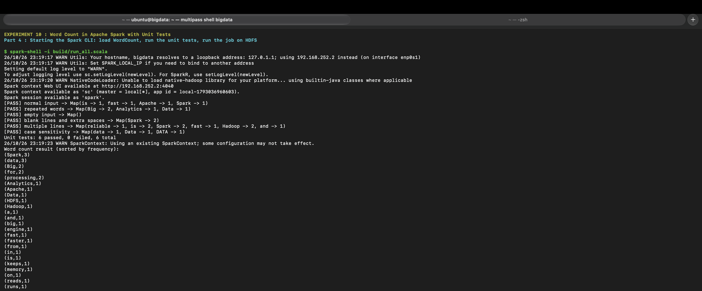

<h1 align="center">🎓 College Lab Work</h1>

  Hands-on lab experiments from my <b>Big Data &amp; Cloud Engineering</b> degree 
  Hadoop · Hive · Pig · Spark · AWS · Machine Learning

  
  
  
  
  
  

  

Each experiment folder has the **report (PDF)**, and where available the **screenshots** of it running.

---

## 🐘 Big Data Technology Lab (`bdtl/`)

| # | Experiment | Tools |
|---|---|---|
| 04 | [MapReduce: matrix multiplication](bdtl/04-mapreduce) | Hadoop MapReduce |
| 05 | [MapReduce: max temperature from weather data](bdtl/05-mapreduce) | Hadoop MapReduce |
| 06 | [Hive operations: create, load, insert, ACID update](bdtl/06-hive-operations) | Hive, HDFS |
| 07 | [Word count in Pig](bdtl/07-pig-word-count) | Pig, HDFS |
| 08 | [Pig: join, group, sort, filter](bdtl/08-pig-join-group-sort-filter) | Pig |
| 09 | [Installing Apache Spark](bdtl/09-spark-installation) | Spark |
| 10 | [Spark word count with unit tests](bdtl/10-spark-word-count) | Spark, Scala |

**Bucket experiments** (extra practice sets)

| Bucket | Topic |
|---|---|
| [06](bdtl/bucket-06-hive) | Hive: table formats (TEXTFILE / ORC / PARQUET), managed vs external, ALTER and DROP |
| [07](bdtl/bucket-07-pig) | Pig: load, inspect and store data |
| [08](bdtl/bucket-08-pig) | Pig: group, aggregate and sort |
| [09](bdtl/bucket-09-spark) | Spark: connect to HDFS and run a sample job |
| [10](bdtl/bucket-10-spark) | Spark: preprocess data, store and visualize results |

Also: [PBA reports](bdtl/pba) · [Databricks &amp; Spark guest lecture report](bdtl/guest-lecture) · [Scripts](bdtl/scripts) (Hive SQL, Pig Latin, Scala and the shell scripts that run them)

---

## ☁️ Cloud Data Engineering (`cloud-engineering/`)

| Item | What it is |
|---|---|
| [S3 → Spark → RDS ETL](cloud-engineering/s3-etl) | Pulls a CSV from Amazon S3, cleans it with PySpark and loads it into PostgreSQL on Amazon RDS |
| [PBA 1: real-time analytics](cloud-engineering/pba/CDE-PBA-1-Realtime-Analytics.pdf) | Counting and windowing on streaming data, with visualization |
| [PBA 2: cloud security audit](cloud-engineering/pba/CDE-PBA-2-Cloud-Security-Audit.pdf) | Access control, encryption and compliance audit (code: [cloud-security-audit](https://github.com/Adesh0512/cloud-security-audit)) |

> The AWS scripts read their settings from environment variables (`BUCKET`, `RDS_ENDPOINT`, `RDS_PASSWORD`, …). No credentials are stored in this repo.

---

## 🤖 AI &amp; ML (`aiml/`)

| File | What it does |
|---|---|
| [mpg_regression.py](aiml/mpg_regression.py) | Predicts car fuel efficiency (MPG) with linear regression on the Auto MPG dataset |
| [bfs_search.py](aiml/bfs_search.py) | Breadth-first search over a graph |
| [astar_search.py](aiml/astar_search.py) | A* search to find the cheapest path in a weighted graph |
